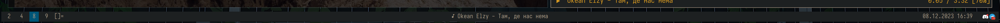

* dwm-polybar
dwm-polybar - a minimal golang script that works as a module for [[https://github.com/polybar/polybar][polybar]] without the need to recompile the entire polybar

** Features
- basic tag module with the same design as in dwm bar

** Install
To install you will need to install Go on your computer
Use ~go install~:
#+BEGIN_SRC shell
go install github.com/Andrmist/dwm-polybar@latest
#+END_SRC

** Usage
#+BEGIN_SRC
Usage:
  dwm-polybar [flags]
  dwm-polybar [command]

Available Commands:
  completion  Generate the autocompletion script for the specified shell
  help        Help about any command
  monitors    helper command to get information about monitors known by dwm

Flags:
      --active-bg string   set background color for active tags (default "#005577")
      --active-fg string   set foreground color for active tags (default "#ffffff")
  -h, --help               help for dwm-polybar
      --monitor int        monitor num if you don't want to auto guess (see dwm-polybar monitors --help) (default -1)
      --padding int        padding in tag (default 1)
      --urgent-bg string   set background color for urgent tags (default "#005577")
      --urgent-fg string   set foreground color for urgent tags (default "#ffffff")

Use "dwm-polybar [command] --help" for more information about a command.
#+END_SRC
If autoguessing monitor doesn't work for you or you have another reason to specify manually your monitor, you can use this subcommand to get proper id for ~--monitor~ parameter:
#+BEGIN_SRC
$ dwm-polybar monitors
Monitor 0 (current):
Selected application name: *doom:vterm-popup:#1* – Doom Emacs
#+END_SRC

After that, add module to your polybar config:
#+BEGIN_SRC ini
[module/dwm]
type = custom/script
exec = dwm-polybar --padding 1 --active-bg #7e9cd8 --urgent-bg #c34043
tail = true
#+END_SRC

** Known bugs
